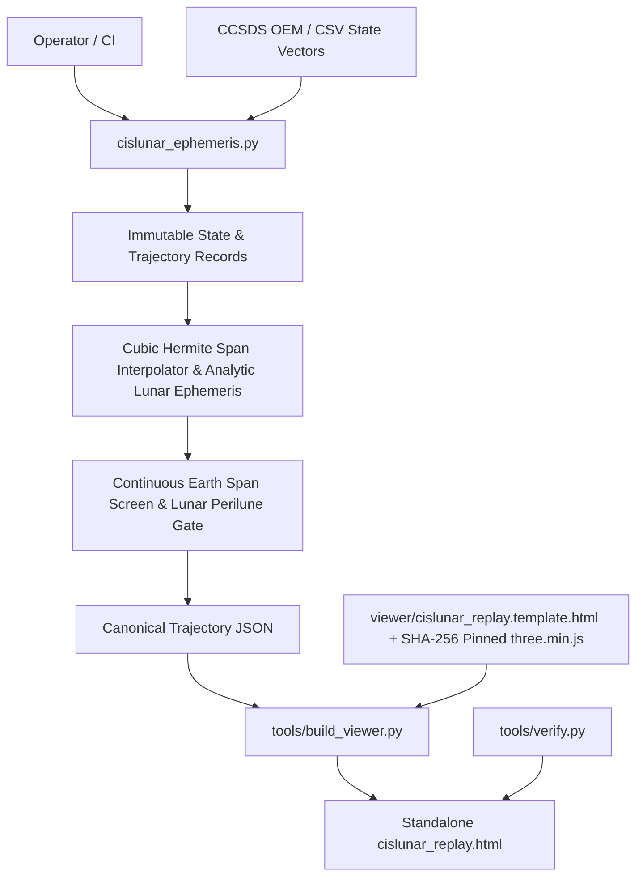
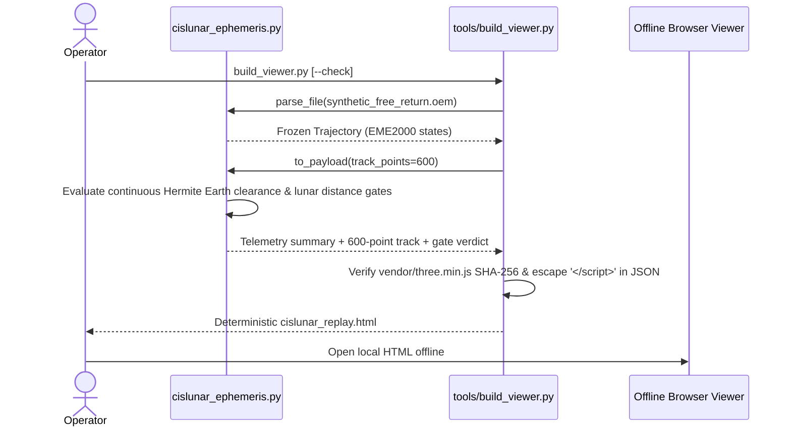

# Architecture: cislunar-oem-replay

Reviewed on 2026-11-07 against the local working tree (`C:/Users/ardhy/Projects/cislunar-oem-replay`). `graphify-out/graph.json` provides the local AST symbol graph.

## 1. System Context & Data Flow

Offline cislunar trajectory parser, cubic Hermite interpolator, continuous Earth/Moon clearance gate, and standalone Three.js HTML viewer builder for CCSDS OEM and CSV state vectors.



## 2. Execution & Pipeline Sequence



## 3. Module Breakdown

| Path | Responsibility |
| :--- | :--- |
| `cislunar_ephemeris.py` | Strict CCSDS OEM & CSV parsers, epoch monotonic validation, binary-search span lookup, cubic Hermite interpolation, analytic lunar ephemeris, continuous Earth-intersection screening, and CLI. |
| `tools/build_viewer.py` | SHA-256 vendor pinning check, template placeholder validation, canonical float rounding, safe `<\/script>` escaping, and `--check` reproducibility gate. |
| `tools/verify.py` | Cross-format OEM/CSV equivalence check and embedded HTML payload parity verifier. |
| `viewer/cislunar_replay.template.html` | Offline Three.js 3D trajectory scrubber, camera controller, and telemetry HUD. |
| `tests/test_cislunar_ephemeris.py` | Parser, Hermite accuracy, frame, and CLI exit-code unit tests. |
| `tests/test_continuous_earth.py` | Sub-span Earth grazing/intersection screening regression tests. |
| `tests/test_viewer_pipeline.py` | Canonical rounding immutability, `</script>` XSS/tag-break escaping, tampered vendor hash refusal, and duplicate placeholder rejection. |

## 4. State Management & Failure Handling

`State` and `Trajectory` are frozen dataclasses normalized to seconds from initial epoch. `build_viewer.py` refuses publication if any clearance gate fails or if `vendor/three.min.js` diverges from its pinned SHA-256 digest. Browser playback state lives strictly in page memory.

## 5. Verification Commands

```powershell
Set-Location 'C:\Users\ardhy\Projects\cislunar-oem-replay'
& 'C:\Python314\python.exe' -m pytest -q
& 'C:\Python314\python.exe' tools/build_viewer.py --check
```

## 6. Integration Boundaries

Uses a synthetic educational free-return profile and low-order analytic lunar ephemeris; no SPICE kernel or live JPL Horizons network query is performed.
