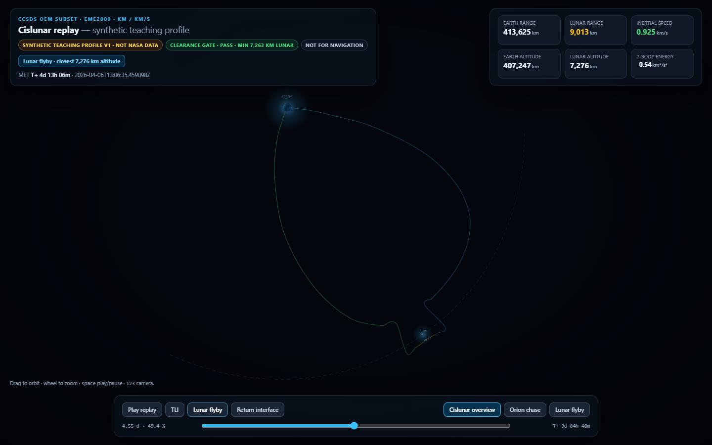
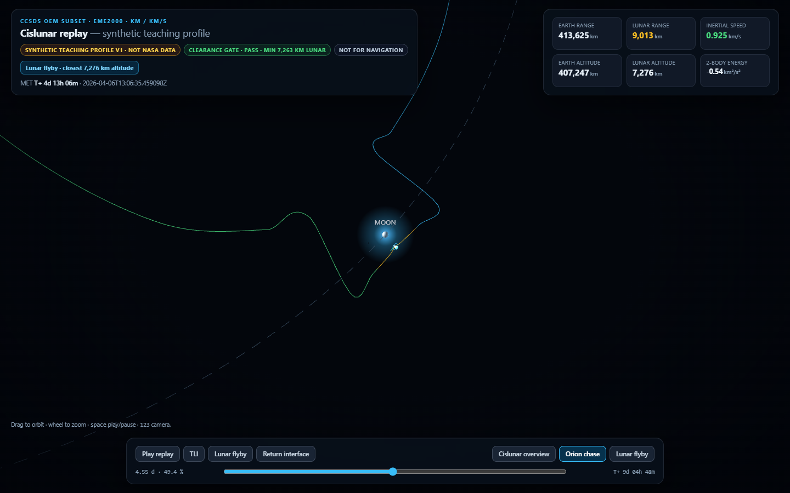

# Cislunar OEM replay — synthetic teaching trajectory

A strict little pipeline for **CCSDS OEM 2.0**-style state vectors: parse, check frame/units/epochs, reconstruct the path with cubic Hermite interpolation, derive range and speed telemetry against a **same-frame lunar ephemeris**, and replay it in a standalone 3D viewer.



The profile is **synthetic**. It is not NASA Artemis data, not a propagated free-return solution and not a navigation product. The parser accepts a documented OEM subset; everything else is rejected with a reason.

## What is in the box

**1. OEM and CSV ingestion (`cislunar_ephemeris.py`)**

- CCSDS OEM 2.0 text: one `META_START/META_STOP` block, `CENTER_NAME=EARTH`, `REF_FRAME=EME2000`, `TIME_SYSTEM=UTC`, km and km/s state vectors.
- A matching CSV replay format (`epoch,x_km,y_km,z_km,vx_kms,vy_kms,vz_kms`) for saved telemetry exports.
- Rejects: wrong version, centre, frame or time system; duplicate metadata; duplicate or non-monotonic epochs; malformed rows; non-finite or out-of-bound numbers; covariance blocks; linear interpolation requests; fewer than three vectors.
- Comments are ignored except `COMMENT PROVENANCE: …`, which is carried into the payload.

**2. Hermite reconstruction and telemetry**

- Cubic Hermite between consecutive states, using the supplied velocities; the derivative is returned as the interpolated velocity. It reproduces every node exactly and is exact for cubic motion.
- Per-sample telemetry: Earth range and altitude, lunar range and altitude, inertial speed, radial velocity and the **Earth two-body specific energy**.
- The two-body energy is a diagnostic, not a conserved quantity of this profile. Its spread is reported rather than hidden: **63.4 km²/s²** across the mission.

**3. Same-frame lunar ephemeris**

- Truncated ELP2000-82B series (Meeus), precessed from the mean equinox of date to **J2000** and rotated with the fixed J2000 obliquity.
- Spot-checked against three JPL Horizons geocentric ICRF vectors: **12, 35 and 13 km** residual (max 34.5 km), with part of that coming from comparing UTC input to TDB-labelled references.
- It is an analytic approximation: fine for teaching ranges and visualisation, not for navigation, occultations or conjunction analysis.

**4. Referee gates**

- Kinematic clearance screen: minimum Earth altitude and minimum lunar altitude must both stay above 100 km.
- A failure is an error, not a silent correction. The CLI exits non-zero and refuses to build the viewer.
- The gate is not a collision probability, trajectory optimisation or mission-design review.

**5. Standalone viewer (`cislunar_replay.html`, generated)**

- One file with three.js and the verified payload embedded; opens from disk without a server or CDN.
- MET scrubber with play/pause, phase labels, three camera locks (cislunar overview, Orion chase, lunar flyby), a velocity arrow whose length scales with speed, and live state telemetry.
- Earth and Moon are drawn at true scale, with halos and labels so they remain findable at cislunar distances.
- Clearance failures and missing values are surfaced as text, never smoothed away.



## Run it

Python 3.11+. No third-party packages.

```sh
python cislunar_ephemeris.py --oem fixtures/synthetic_free_return.oem --out data/trajectory.json
python tools/generate_fixture.py     # regenerate OEM + CSV from the profile
python tools/build_viewer.py         # rebuild the standalone viewer
start cislunar_replay.html           # Windows
```

CSV route:

```sh
python cislunar_ephemeris.py --csv fixtures/synthetic_free_return.csv --out data/from_csv.json
```

## Verification

| Check | Result |
| --- | --- |
| `pytest` | 43 passed |
| OEM vs CSV replay | identical samples |
| Gate status | pass |
| Minimum Earth altitude (track) | 199.9 km |
| Minimum lunar altitude (track) | 7,275.7 km |
| Maximum Earth range | 420,122 km |
| Peak inertial speed | 10.74 km/s |
| Two-body energy spread | 63.4 km²/s² (diagnostic only) |
| Lunar ephemeris vs Horizons (3 epochs) | 12 / 35 / 13 km, max 34.5 km |
| Browser QA (Chromium, SwiftShader) | 0 console errors, 3 camera modes, scrubber verified |
| Viewer payload vs parser output | byte-identical |
| External assets / network fetch | none |

`tools/verify.py` writes `reports/verification.json`; `tools/check_ephemeris.py` writes `reports/moon-ephemeris-check.json`; `tools/browser_qa.mjs` writes `docs/browser-qa.json` plus four screenshots.

## The synthetic profile

`tools/generate_fixture.py` builds a 9.2-day reference geometry:

- 30 states from 2026-04-02 to 2026-04-11.
- Outbound coast to roughly lunar distance, a close pass at **7,263 km lunar altitude**, and a return to a 200 km Earth perigee.
- Each waypoint is placed relative to the **computed Moon position at that same epoch**, so lunar-range telemetry stays physically coherent.
- Node velocities are **cubic-spline derivatives** of that geometry. They are not the output of a gravity model. The TLI-like initial speed (10.74 km/s) and the ~0.43 km/s cruise speed are plausible, but the acceleration is not integrated and the energy varies.

This distinction is deliberate: the tool demonstrates data ingestion, validation, interpolation and visualisation honestly, without claiming a flight-dynamics solution it does not compute.

## OEM subset rules

| Item | Accepted |
| --- | --- |
| Version | `CCSDS_OEM_VERS = 2.0` |
| Centre | `EARTH` |
| Frame | `EME2000` |
| Time system | `UTC` (ISO-8601 with `Z`) |
| Units | km, km/s (OEM default) |
| State vectors | ≥ 3, strictly increasing epochs, 7 columns |
| Meta blocks | exactly one |
| Interpolation | `HERMITE` or absent |

## Limits

- No propagation, manoeuvre modelling, covariance, light-time, aberration, station geometry or planetary perturbation.
- No TAI/TT/TDB/UT1 conversion: UTC only.
- Lunar ephemeris is truncated; residuals are tens of kilometres, not metre-level.
- Only the documented seven-column state-vector block; no covariance or attitude records.
- The viewer is a replay, not an analyst tool; it does not edit or filter the trajectory.
- Browser QA ran on software WebGL in headless Chromium, so frame timing is not a performance measurement.

## Provenance and licence

All trajectory data is invented for teaching, labelled `SYNTHETIC_TEACHING_PROFILE_V1`. The lunar ephemeris is computed locally from published series. No authenticated NASA product is redistributed.

MIT — see [LICENSE](LICENSE).
